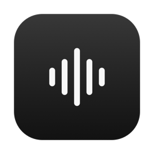
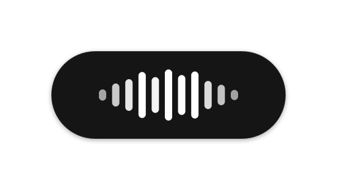

<p align="center">
  
</p>

<h1 align="center">Whisperly</h1>

<p align="center">
  Hold <kbd>Fn</kbd>, speak, let go. Your words appear wherever your cursor is.<br>
  An open-source, fully on-device take on Wispr Flow for macOS.
</p>

<p align="center">
  
</p>

---

Whisperly is a small menu bar app that turns your voice into text in any app: email, Slack, notes, code editors, the browser. It runs OpenAI's Whisper speech model locally on your Mac, so nothing you say leaves your computer and there's no subscription or account.

> Whisperly is an independent project. It isn't affiliated with or endorsed by Wispr or OpenAI.

## Features

- **Push-to-talk on the Fn (🌐) key.** Hold to record, release to paste. Works in any app.
- **Fully on-device.** Transcription runs locally with Whisper via WhisperKit. No cloud, no API keys, works offline after the first model download.
- **Pastes for you.** The text lands at your cursor, and your clipboard is restored right after.
- **A small floating pill.** A compact black capsule opens from the center when you start talking, shows live voice bars, and closes the moment you let go.
- **Lives in the menu bar.** No Dock icon or windows. The menu shows status, your last 10 transcripts (click to copy), and settings.
- **Choose your model.** Switch between Whisper `tiny.en`, `base.en` and `small.en` (default) depending on speed versus accuracy.
- **Starts at login.** Turned on by default and can be toggled from the menu.
- **Clean output.** Strips Whisper's special tokens and silence markers like `[BLANK_AUDIO]`.
- **Respects Reduce Motion.** Animations are skipped when the system setting is on.

## How it works

```
Fn down ─▶ AVAudioEngine captures mic ─▶ resampled to 16 kHz mono
                     │
                     └─▶ live level meter ─▶ floating pill
Fn up ───▶ WhisperKit (Whisper on Core ML) ─▶ text cleanup
                     ─▶ clipboard + simulated ⌘V ─▶ clipboard restored
```

1. **Hotkey:** a global `NSEvent` monitor watches the Fn key's modifier flag.
2. **Recording:** `AVAudioEngine` taps the microphone, and `AVAudioConverter` resamples to the 16 kHz mono Float32 audio Whisper expects.
3. **Transcription:** [WhisperKit](https://github.com/argmaxinc/WhisperKit) runs a Core ML build of Whisper on the CPU and GPU. Models download once from Hugging Face (`argmaxinc/whisperkit-coreml`) into `~/Documents/huggingface/`.
4. **Paste:** the text goes on the clipboard, a `⌘V` keystroke is sent with `CGEvent`, and the previous clipboard is put back.

A note on performance: Whisperly runs the model on the GPU rather than the Neural Engine. On recent macOS versions the Neural Engine recompiles the model on every launch and first use, which can take a minute or more. The GPU path loads in seconds and transcribes a sentence in about a second.

## Built with

| | |
|---|---|
| Language | Swift 5.9, Swift Package Manager |
| UI | AppKit: `NSStatusItem` menu bar app, borderless `NSPanel` overlay, custom-drawn waveform |
| Audio | AVFoundation: `AVAudioEngine`, `AVAudioConverter` |
| Speech-to-text | [WhisperKit](https://github.com/argmaxinc/WhisperKit) by Argmax, on Core ML |
| Model | [OpenAI Whisper](https://github.com/openai/whisper), English-only `tiny`, `base` and `small` variants |
| System | `CGEvent` for paste, Accessibility API, `SMAppService` for login item |

The app is under 900 lines of Swift across seven files, with no Xcode project. It's a plain Swift package plus a build script that assembles the `.app` bundle.

```
Sources/Whisperly/
├── App.swift            entry point, menu bar-only app
├── AppDelegate.swift    menu, dictation flow, model loading, login item
├── HotkeyManager.swift  Fn key monitor
├── AudioRecorder.swift  mic capture + 16 kHz resampling
├── Transcriber.swift    WhisperKit wrapper and text cleanup
├── OverlayPanel.swift   floating pill + animated voice bars
└── Paster.swift         clipboard + ⌘V
```

## Requirements

- macOS 14 Sonoma or later
- An Apple Silicon Mac (M1 or newer) is recommended
- Xcode 15+ or the Xcode Command Line Tools (for `swift`)
- About 500 MB free for the default `small.en` model

## Build and install

```bash
git clone https://github.com/RyanGiang8/Whisperly.git
cd Whisperly
./build_app.sh
open /Applications/Whisperly.app
```

`build_app.sh` builds a release binary, assembles `Whisperly.app`, signs it and installs it into `/Applications`.

On first launch:

1. Allow **Microphone** access when asked.
2. Turn on Whisperly in **System Settings → Privacy & Security → Accessibility**. This is needed to detect the Fn key and paste text.
3. Wait for the menu bar status to read **Ready**. The first run downloads the model, which takes a minute.
4. In **System Settings → Keyboard**, set "Press 🌐 key to" to **Do Nothing** so macOS doesn't open the emoji picker or its own dictation.

### Keeping permissions across rebuilds

By default the app is signed ad-hoc, which means macOS asks for permissions again after every rebuild. To avoid that, create a self-signed code-signing certificate in Keychain Access (Certificate Assistant → Create a Certificate → type "Code Signing"), then tell the build script its name:

```bash
echo "Your Certificate Name" > .signing-identity
```

## Usage

| Action | How |
|---|---|
| Dictate | Hold <kbd>Fn</kbd>, speak, release |
| Copy a recent transcript | Menu bar icon → click an item under "Recent" |
| Change model | Menu bar icon → Model |
| Toggle start at login | Menu bar icon → Start at Login |
| Restart | Menu bar icon → Restart Whisperly (<kbd>⌘R</kbd>) |

## License

[MIT](LICENSE) © 2026 Ryan Giang

Whisper is released by OpenAI under the MIT license. WhisperKit is released by Argmax under the MIT license.
